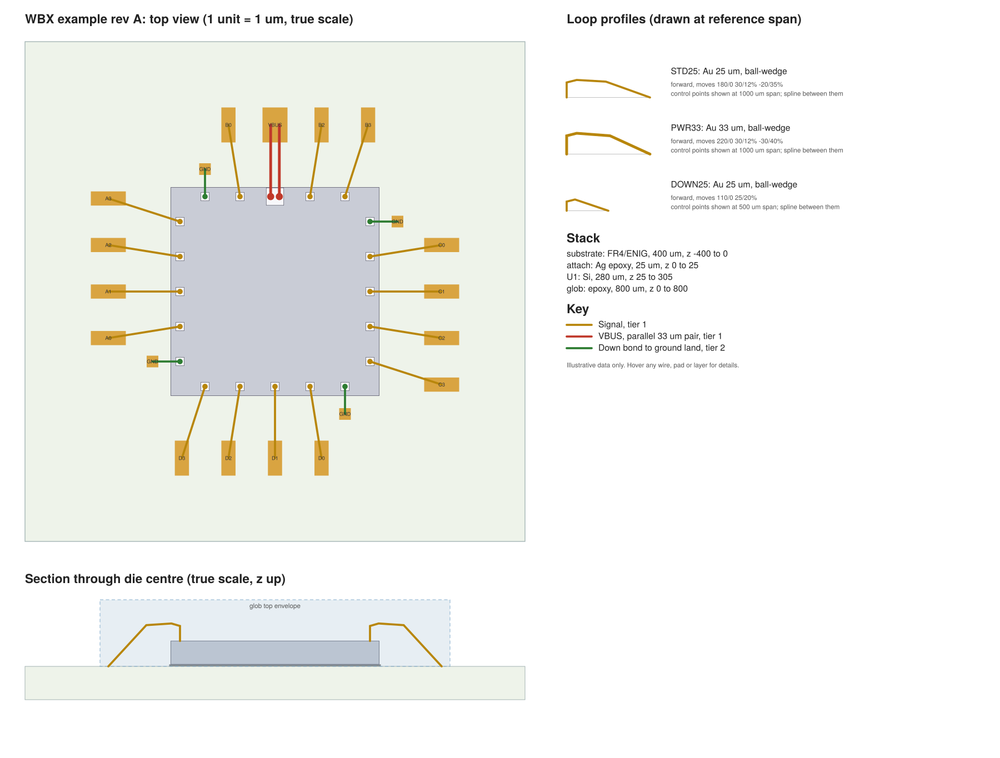

# WBX: a viewable wire bond exchange format

WBX (working name) is a restricted SVG profile for describing a wire bonded assembly. A `.wb.svg` file opens in any browser as a true-scale bonding diagram, and tools read the same file as data.

**Status: prototype, v0.1 draft.** All example data is illustrative. Nothing here has been run through a real bonder or offline programming tool.



## The idea

- The picture is the data: 1 SVG unit = 1 µm, `stroke-width` is wire diameter, `rect` is a pad opening.
- Height lives in a drawn section view, where a rectangle's height is that layer's thickness.
- Everything else sits on drawn elements as `wb:` attributes.
- Loop shapes are parametric, so one profile fits any wire span.
- Wires reference pads by name, and a checker catches geometry that has drifted.

See [SPEC.md](SPEC.md) for the format and [docs/report.md](docs/report.md) for the design reasoning and prior-art survey.

## Try it

```sh
pip install lxml ezdxf gdstk pytest
python wbx.py check examples/example.wb.svg
python wbx.py export examples/example.wb.svg /tmp/example
python examples/make_example.py   # rebuilds the example from a generated GDS
python -m pytest
```

Open `examples/example.wb.svg` in a browser and hover over any wire, pad or layer.

## What works

| Path | State |
|---|---|
| GDS to `.wb.svg` | Pad extraction tested on a generated GDS; the assembly side is hard-coded in `examples/make_example.py` |
| Parse and rewrite | Byte-identical on the example |
| Checks | Bond on pad, net agreement, wire diameter, loop against cap, die edge clearance, plan-view wire gap |
| Bondlist CSV and 3D DXF export | Generated; not loaded in a bonder tool |
| KiCad import and export | Not built |

Known limits of the prototype: one die, a fixed canvas size, µm and percent moves only (no angles), and a plan-view wire gap check that doesn't yet account for loop height.

## Handling files

Do not run `.wb.svg` files through SVGO or other minifiers. They convert shapes to paths and remove `id` values, which breaks parsing. Editing in Inkscape, Illustrator or Figma is untested.

## Related work

[open.cob.json](https://github.com/MaxClerkwell/open.cob.json) is a JSON exchange format for chip-on-board wire bonding with a broader data model and working KiCad export. This project overlaps with it, and the report recommends contributing the viewable SVG form there rather than competing.
