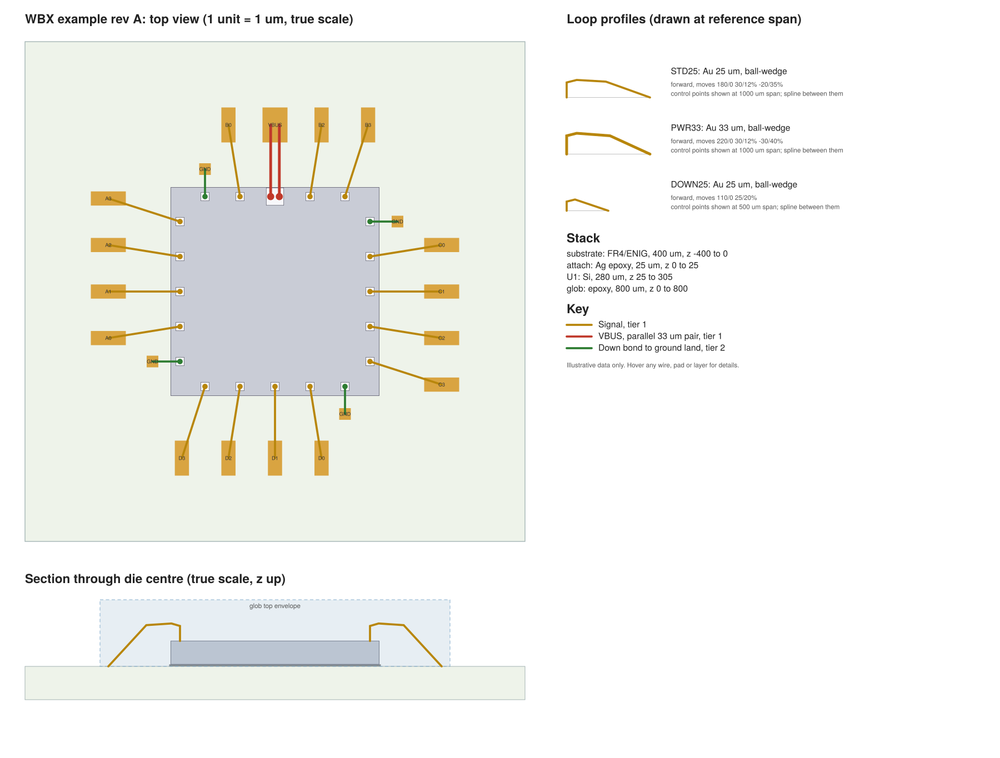
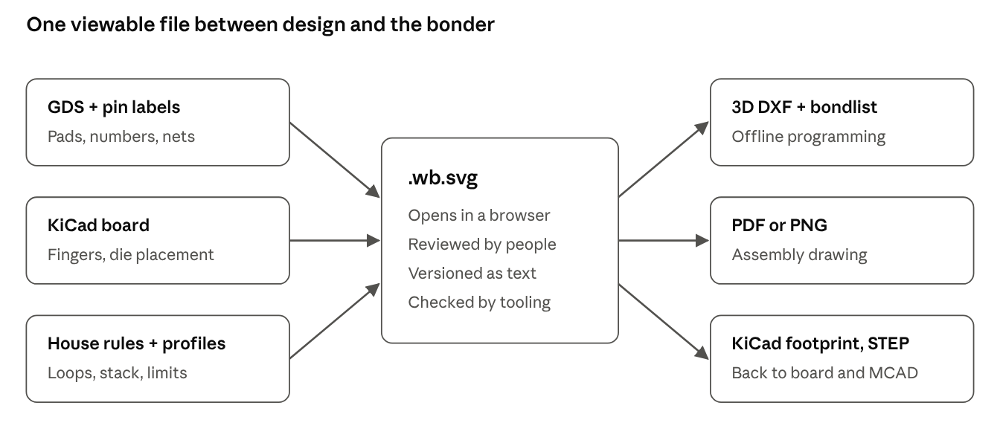

# SVG-Based Wire Bond Exchange Format: Design Report

Design report, November 2026. It records the reasoning behind this prototype.

## Summary

**Update after the prior-art search:** no industry standard exists, but a new open format, open.cob.json, overlaps this work. The recommendation is now to contribute the viewable SVG form to that project rather than launch a rival. See the prior-art section.

SVG works as a wire bond exchange format if the drawn shapes are the data and a small wb: namespace adds only what a 2D drawing cannot express. I built a prototype to test this: a GDS went in, a viewable SVG came out, and a parser rebuilt the same file byte for byte from the SVG alone (21 wires, 20 pads, 21 KB).

The working name is WBX, with the extension .wb.svg. Five decisions define it:

- **The picture is the data.** One SVG unit is 1 µm, stroke-width is the wire diameter, and a rect is a pad opening.

- **Z lives in a drawn section view.** A die's thickness is the height of its rectangle in that view.

- **Everything else sits on drawn elements as wb: attributes.** Avoid a \<metadata\> block, because common tools delete it.

- **Loop shapes are parametric.** A profile is a list of moves that adapts to each wire's span and height, the same model Cadence uses.

- **Connectivity uses names, and a checker catches drift.** Wires reference pads by name, so a hand edit that breaks the geometry gets flagged.

The main limit is that WBX is a design-intent format. Bonders run on vendor programs, so WBX must export to what offline programming accepts, and a loop profile remains a target until the bonding engineer tunes it.

## The gap

None of the established sources carries pads, wires, loop shape and die stack together in a form you can simply open. Each holds part of the picture.

| Source                             | Carries                                                                                                                                               | Missing                                                                                                                                                                                                                                                |
|------------------------------------|-------------------------------------------------------------------------------------------------------------------------------------------------------|--------------------------------------------------------------------------------------------------------------------------------------------------------------------------------------------------------------------------------------------------------|
| GDSII                              | Pad geometry on the opening layer                                                                                                                     | [No numbering or netlist, generally](https://sst.semiconductor-digest.com/?p=34154)                                                                                                                                                                    |
| Die netlist (spreadsheet or ASCII) | [Pad number, coordinates, net name](https://sst.semiconductor-digest.com/?p=34154)                                                                    | Package, wires, Z                                                                                                                                                                                                                                      |
| IPC-2581                           | Wire bond definitions                                                                                                                                 | [An envelope only, not the wire path or structure](https://iconnect007.uberflip.com/i/1417991/38)                                                                                                                                                      |
| Cadence Allegro Package Designer   | [3D DXF for offline programming, plus XML profiles](https://community.cadence.com/cadence_blogs_8/b/pcb/posts/allegro-package-designer-and-3d-dxf)    | Requires a commercial tool; the profile XML is Cadence's                                                                                                                                                                                               |
| Altium Designer                    | [Loop height, diameter, angles, ball or wedge type; CSV table and STEP export](https://www.altium.com/documentation/altium-designer/pcb/wire-bonding) | A report, not a two-way exchange file                                                                                                                                                                                                                  |
| KiCad                              | Ordinary footprints and pads                                                                                                                          | I found no native bond wires in [KiCad 10 coverage](https://www.kicad.org/blog/2026/03/Version-10.0.0-Released/index.html); [users have asked for wire diameter, material and bend profile](https://forum.kicad.info/t/chiplets-and-interposers/60987) |
| Bondlist text file                 | [Bond coordinates and connectivity](https://file.scirp.org/Html/2573.html)                                                                            | Any visual form, and loop intent                                                                                                                                                                                                                       |

The target is also well defined. Offline programming needs [wire endpoints precise to a few microns, a 1:1 drawing, and wires sorted by bonding tier](https://sst.semiconductor-digest.com/?p=34154). WBX has to supply at least that.

## Prior art: is industry already using a format?

I found no industry standard for wire bond data, but the open field is no longer empty. Industry runs on DXF, PDF, and each bonder vendor's own program. A new open format, open.cob.json, appeared in September 2026 and solves much of this same problem.

### What industry actually uses

| Handoff                               | What is used                                                                                                                                                                                                                                                         | Shared standard?                           |
|---------------------------------------|----------------------------------------------------------------------------------------------------------------------------------------------------------------------------------------------------------------------------------------------------------------------|--------------------------------------------|
| Customer to assembly house            | [Bond diagram as PDF, plus a netlist table of signal, die pad, package pin and X,Y](https://anysilicon.com/submitting-design-files-assembly-house-checklist/)                                                                                                        | Convention only                            |
| Package design to offline programming | [3D DXF plus profile XML from Cadence, developed with bonder vendors](https://community.cadence.com/cadence_blogs_8/b/pcb/posts/allegro-package-designer-and-3d-dxf)                                                                                                 | DXF is de facto; layer meaning is per tool |
| Coordinates to machine                | [ASCII bondlist converted per machine; delimiters differ by machine](https://www.scirp.org/html/2573.html)                                                                                                                                                           | No                                         |
| Machine program                       | [Vendor OLP tools, often tied to a specific CAD version](https://file.scirp.org/Html/2573.html); [Hesse bonders take an XML wire file generated from DXF polylines](https://epp-europe-news.com/top-news/news/hesse-mechatronics-partners-with-cad-design-software/) | No, vendor-specific                        |
| Inside large manufacturers            | [A patent describes an in-house standard file, translated to each bonder's machine language](https://image-ppubs.uspto.gov/dirsearch-public/print/downloadPdf/7631795)                                                                                               | Private                                    |

So the format people worry about most likely isn't one format. It's a DXF drawing, a table and a PDF, plus private machine recipes. I found no public specification of a Kulicke & Soffa or ASMPT program file.

### Standards that touch the problem

| Standard                                                                                                           | Covers                                                                                                                                   | Why it isn't the answer                                                                                                                                                                                 |
|--------------------------------------------------------------------------------------------------------------------|------------------------------------------------------------------------------------------------------------------------------------------|---------------------------------------------------------------------------------------------------------------------------------------------------------------------------------------------------------|
| [IEC 62258-2 DDX](https://dtsheet.com/doc/1287219/ddx-file-format)                                                 | Bare die: size, thickness, pad shape, position, connection, in readable text                                                             | Die only; the material I read doesn't mention wires or loops. Worth aligning field names                                                                                                                |
| [JEDEC JESD59](https://www.jedec.org/node/7486)                                                                    | How to model a bond wire, 1997                                                                                                           | A modeling method, not a file. Its [4-point and 5-point shapes are still built into Ansys SIwave](https://www.oldfriend.url.tw/SIwave/ansys_ch_Package_Plane_Impedance.html), so WBX should map to them |
| [IPC-2581C](https://www.protoexpress.com/blog/ipc-2581-revision-c-facilitates-pcb-data-management-by-hemant-shah/) | Board data, with [wire bond components added](https://www.protoexpress.com/?p=11086)                                                     | [An envelope, not the path](https://iconnect007.uberflip.com/i/1417991/38), per a committee interview; I did not read the schema                                                                        |
| [IEEE P3537 3Dblox](https://standards.ieee.org/ieee/3537/11871)                                                    | Chiplet stacks and connectivity; still an active draft project                                                                           | Placement-and-route level, [with no wire-bond pad target](https://ihp-open-adk-docs.readthedocs.io/en/latest/formats/08_3dblox_interop.html)                                                            |
| [JEDEC JEP30 with CDXML](https://www.jedec.org/node/9418)                                                          | XML part description for chiplets                                                                                                        | Describes the part, not the assembly                                                                                                                                                                    |
| STEP AP210                                                                                                         | ECAD and MCAD models; [a part module excludes internal wiring for manufacturing use](https://www.iso.org/standard/42404.html?browse=ics) | Heavy; not found in any bonding flow                                                                                                                                                                    |

### Open projects

| Project                                                                                          | What it is                                                                                            | Relationship to WBX                                                                                                                                        |
|--------------------------------------------------------------------------------------------------|-------------------------------------------------------------------------------------------------------|------------------------------------------------------------------------------------------------------------------------------------------------------------|
| [open.cob.json](https://github.com/MaxClerkwell/open.cob.json)                                   | JSON exchange format for chip-on-board wire bonding, CC BY 4.0, with GDS import and KiCad 9/10 export | Direct overlap                                                                                                                                             |
| [IHP .chiplet](https://ihp-open-adk-docs.readthedocs.io/en/latest/formats/01_chiplet.html)       | YAML assembly format for interposers, Apache-2.0, preview release, KiCad-connected                    | Places die and [lists wire-bond pads](https://ihp-open-adk-docs.readthedocs.io/en/latest/formats/02_chiplet_components.html); no individual wires or loops |
| [FreeCAD Chip-Packaging Workbench](https://github.com/Haggi84/FreeCAD-Chip-Packaging-Workbench-) | GDS import, 3D wire placement, DRC                                                                    | Saves native FreeCAD documents; a tool, not an exchange format                                                                                             |
| [freecad-wire-bonder](https://github.com/panjh/freecad-wire-bonder)                              | Makes a parametric wire between two faces                                                             | Geometry helper                                                                                                                                            |
| [Wirebonding (WOSET 2020)](https://github.com/ppxscal/Wirebonding)                               | Generates diagrams from LEF                                                                           | Generator; [its paper also calls this area proprietary](https://woset-workshop.github.io/PDFs/2020/a06.pdf)                                                |
| [kotoba-lang/pkg](https://github.com/kotoba-lang/pkg)                                            | Clojure package modeling library                                                                      | Data structures only                                                                                                                                       |

### open.cob.json compared with this design

I cloned the repository (latest commit 1 November 2026) and read its data model. Its author says [wafer.space's Stuart Childs encouraged him to publish it](https://github.com/namibj/open.cob.json). It is marked work in progress.

| Need                                  | open.cob.json                                                       | WBX prototype                      |
|---------------------------------------|---------------------------------------------------------------------|------------------------------------|
| File is itself viewable               | No. A tool renders JSON to SVG; the demo SVG has no data attributes | Yes                                |
| Demo size                             | 1,300 lines for 9 wires                                             | 301 lines for 21 wires             |
| Die thickness, stack                  | Thickness with tolerance; bondline in assembly                      | Drawn section view                 |
| Loop curve                            | Named shape, height, max height; explicit paths deferred past v1    | Parametric moves that fit any span |
| Bond sequence and tier                | I found none per wire; sequence orders process steps                | wb:seq, wb:tier                    |
| Tolerances                            | Nominal, tolerance or min/typ/max on any value                      | Rule limits only                   |
| Bond force, time, power, pull tests   | Yes                                                                 | No                                 |
| Electrical limits, differential pairs | Yes                                                                 | No                                 |
| none versus unspecified               | Explicit, and useful                                                | No                                 |
| KiCad                                 | Exports symbol and footprint today                                  | Designed only                      |
| GDS import                            | Yes, with PDK awareness                                             | Prototype                          |

The line counts aren't like for like, because its demo carries process data that WBX lacks. They do show the long JSON that a viewable format avoids.

### Recommendation

Don't launch a rival schema; work with open.cob.json and bring the SVG to it. Its data model is broader, and it already has KiCad and GDS tools and wafer.space contact. What's missing is a file that a person can open and that tools can trust.

Three contributions fit:

1.  **A lossless SVG form.** Make cobviz output carry the data as this report describes, so .cob.json and .cob.svg convert both ways.

2.  **Parametric loop profiles.** Add wb:moves as a loop shape, mapped to the JEDEC 4-point and 5-point models.

3.  **Per-wire bond sequence and tier**, which offline programming needs.

If the maintainer declines, WBX can still import and export his format.

### Limits of this search

- GitHub's own repository and code search was unavailable: the API needs a linked GitHub account, and the web pages returned errors. I used web search limited to GitHub, plus direct clones, so smaller repositories may be missed.

- SEMI, IPC and many IEC documents are paid. JESD59 and the IPC-2581C schema weren't read, and a private bonder format wouldn't appear publicly.

- The quickest remaining check is to ask a packaging house and a K&S or ASMPT applications engineer what their offline tools ingest.

## Core design

The governing rule is that if it isn't drawn, it isn't in the file. This keeps the format viewable, and it means the file a person reviews is the file a tool reads.

| Fact                              | Where it lives                                      | Example                          |
|-----------------------------------|-----------------------------------------------------|----------------------------------|
| Scale                             | 1 SVG user unit = 1 µm                              | viewBox in µm                    |
| Pad or finger size                | rect width and height                               | width="100"                      |
| Wire diameter                     | stroke-width at true scale                          | stroke-width="25"                |
| Bond points                       | Ends of the wire line                               | x1, y1, x2, y2                   |
| Die placement                     | One transform on the die group                      | translate(1750 4250) scale(1 -1) |
| Pad coordinates                   | Inside the die group, in native GDS numbers         | x="60" y="360"                   |
| Thickness and Z                   | rect in the section view, where height is thickness | height="280"                     |
| Loop shape                        | Profile group with wb:moves, drawn as a polyline    | 180/0 30/12% -20/35%             |
| Net, connectivity, sequence, tier | wb: attributes on the wire                          | wb:from="U1.7"                   |

The die transform flips Y, so pad coordinates in the file match GDS exactly and can be compared by eye. Moving or rotating a die changes a single attribute.

### Why attributes and not a metadata block

The [SVG specification lets foreign-namespace elements and attributes appear anywhere](https://www.w3.org/TR/2015/WD-SVG2-20150409/extend.html), and viewers ignore them. The question is what survives other software, so I ran the example through SVGO, the common SVG minifier, with default settings.

| Content                          | After SVGO        |
|----------------------------------|-------------------|
| wb: attributes on drawn elements | Kept              |
| data-\* attributes               | Kept              |
| \<title\> hover text             | Kept              |
| \<metadata\> block               | Deleted           |
| Foreign elements in \<defs\>     | Deleted           |
| id on a wire                     | Deleted           |
| rect and line shapes             | Converted to path |

Three rules follow. Per-element attributes hold the data, names go in wb:name and never in id, and minifiers are forbidden because the converted shapes broke my parser. \<metadata\> is still fine for non-essential provenance such as author or tool version.

I chose wb: over data-\* because a namespace can be validated as a schema and avoids collisions. [data-\* names also can't contain capitals](https://developer.mozilla.org/docs/Web/SVG/Reference/Attribute/data-*). The namespace is urn:wbx:0.1, which needs no domain.

### Keeping the drawing honest

A wire's endpoints are the bond points, and wb:from and wb:to are the connectivity. A checker confirms each endpoint falls inside the named pad. When I moved the die 200 µm in the file and left the wires alone, the checker reported 27 errors.

The profile should also forbid scripts and limit transforms to translate, rotate and scale(1 -1). Coordinates keep three decimals, which is 1 nm. Parsers should read the decimal text, since renderers may round to lower precision.

## Data model

Seven element kinds cover a single-die assembly, and five more entries are needed before it can drive production. "Built" means the prototype writes and parses that field.

| wb:kind                           | SVG element          | Attributes                                                  | Status   |
|-----------------------------------|----------------------|-------------------------------------------------------------|----------|
| root (svg)                        | svg                  | version, units, design, rev, rule-wire-gap, rule-edge-clear | Built    |
| die                               | g                    | name, gds-cell, pad-layer                                   | Built    |
| pad                               | rect in die group    | name, net                                                   | Built    |
| land (finger or down-bond target) | rect                 | name, net, finish                                           | Built    |
| wire                              | line                 | name, from, to, profile, seq, tier, net                     | Built    |
| layer (stack)                     | rect in section view | name, role, material                                        | Built    |
| profile                           | g with polyline      | name, material, style, dir, moves, interp, ref-span         | Built    |
| fiducial                          | circle or path       | name, role; machine alignment points                        | Proposed |
| wire additions                    | line                 | via for stitch chains, security-bump                        | Proposed |
| profile additions                 | g                    | min, max, vendor-name, certified-by                         | Proposed |
| keepout                           | rect or path         | Tall-part and bondhead clearance, with a height             | Proposed |
| die additions                     | g                    | stack-layer, for multi-die stacks                           | Proposed |

### Loop profiles

The curve follows [Cadence's model](https://www.ema-eda.com/wp-content/uploads/2024/01/wire-bond-profiles.pdf). A profile is an ordered list of steps, and each step has a vertical and a horizontal part. Each part can be an absolute length, a percentage of the wire's span, or an angle. The last segment is computed as a straight line to the second bond, so one profile fits any wire.

In wb:moves, each token is vertical/horizontal. 180/0 30/12% -20/35% means rise 180 µm, then rise 30 µm over 12% of span, then fall 20 µm over 35% of span, then go straight to the second bond. The prototype handles µm and percent; angles still need adding.

Two refinements are worth taking from existing tools. Cadence profiles can give [minimum and maximum values for a point](https://community.cadence.com/cadence_blogs_8/b/pcb/posts/how-to-define-your-own-team-certified-wire-profiles), which suits a format stating intent. Altium adds [start and end angles](https://www.altium.com/documentation/altium-designer/pcb/wire-bonding), which wb:moves can express once angles are in.

### Why the stack matters

Accurate clearance checks need [accurate wire profiles and accurate die stack heights](https://community.cadence.com/cadence_blogs_8/b/pkg/posts/default-bond-wire-profile). A wrong die thickness gives wrong wire heights, and a collision with a mold cap or another die can go undetected. Because thickness is drawn to scale here, a mistake of that kind is also visible in the section view.

### What the data can check

The prototype currently checks bonds on pads, net agreement, stroke width against profile, loop height against cap, clearance at the die edge, and plan-view wire gap. Together those resemble [Altium's wire-to-wire and finger-margin rules](https://www.altium.com/documentation/altium-designer/pcb/wire-bonding). Thresholds travel in the file because they vary by house and tool: [CERN's bond lab cites 60 µm pitch with 25 µm aluminium wire, at a limited loop height](https://ssd-rd.web.cern.ch/DSF/bond_lab/Hybrid_Design.htm).

## Worked example

The file example.wb.svg, in `examples/`, is a complete assembly that opens in any browser. It has a true-scale top view, a section view, the loop library and a key, and hovering any wire shows its details. All values in it are illustrative.

A wire is one readable element:

\<line x1="2580" y1="1860" x2="2441.4" y2="1000" stroke-width="25"  
class="w sig" wb:kind="wire" wb:name="W07"  
wb:from="U1.7" wb:to="L7" wb:profile="STD25"  
wb:seq="7" wb:tier="1" wb:net="B0"\>  
\<title\>W07 B0: U1.7 to L7, Au 25 um, STD25, seq 7, tier 1\</title\>  
\</line\>

The die, a pad in GDS coordinates, and the die's thickness in the section view:

\<g transform="translate(1750 4250) scale(1 -1)" wb:kind="die"  
wb:name="U1" wb:gds-cell="EXAMPLE_DIE" wb:pad-layer="37/0"\>  
\<rect x="60" y="360" width="100" height="100"  
wb:kind="pad" wb:name="1" wb:net="GND"/\>  
\</g\>  
  
\<rect x="1750" y="-305" width="2500" height="280"  
wb:kind="layer" wb:name="U1" wb:role="die" wb:material="Si"/\>

A loop profile, with its parametric definition and its drawing:

\<g wb:kind="profile" wb:name="STD25" wb:material="Au"  
wb:style="ball-wedge" wb:dir="forward" wb:interp="spline"  
wb:moves="180/0 30/12% -20/35%" wb:ref-span="1000"\>  
\<polyline points="0,0 0,-180 120,-210 470,-190 1000,0" stroke-width="25"/\>  
\</g\>

The prototype's checks on this file:

| Check                                              | Result              |
|----------------------------------------------------|---------------------|
| Parse and rewrite, compared with the original      | Byte-identical      |
| Bond points on named pads, nets agree              | 21 of 21 wires pass |
| Wire length, 3D                                    | 694 to 1,341 µm     |
| Highest loop against 800 µm cap                    | 555 µm              |
| Lowest clearance at die edge (rule: 40 µm)         | 62 µm               |
| Smallest plan-view gap between wires (rule: 60 µm) | 362 µm              |

## Toolchain

GDS to WBX and WBX to DXF both work in the prototype; the KiCad link is designed but not built. Each design tool and manufacturing output talks only to the .wb.svg, so a new tool needs one converter.

WBX data flow · 3 sources, 3 outputs

| Path                   | Method                                                  | Status                                               |
|------------------------|---------------------------------------------------------|------------------------------------------------------|
| GDS to WBX             | gdstk reads pad polygons and text labels                | Tested on a generated GDS                            |
| WBX to bondlist CSV    | Sorted by sequence, with X, Y, Z for both bonds         | Tested                                               |
| WBX to 3D DXF          | One 3D polyline per wire, tagged by tier                | Generated and read back; not loaded in a bonder tool |
| WBX to PNG             | rsvg-convert                                            | Tested                                               |
| KiCad to WBX           | Plugin reads footprint pads; wires held on a user layer | Designed                                             |
| WBX to KiCad footprint | Fingers as pads, wires as graphics                      | Designed                                             |
| WBX to STEP or glTF    | Sweep a circle along each evaluated loop                | Designed                                             |

**GDS.** Pad openings on GF180MCU are [layer 37, datatype 0](https://foss-eda-tools.googlesource.com/gf180mcu-pdk/+/0cba32596b0dbc82f53d16b4d1adfebd1ecf9eb3/docs/physical_verification/design_manual/tables_clear/06_Drawn_layer10.csv), so the example records that in wb:pad-layer. Pin names need a source, since GDS generally lacks them. The prototype used synthetic labels on 53/0; a real flow would use the PDK's pin label layer or DEF.

**KiCad.** A KiCad user has already described [a script from DEF to a footprint and symbol for wire bonded die](https://forum.kicad.info/t/chiplets-and-interposers/60987), so that direction has precedent. KiCad won't know a wire connects two nets, so WBX should own connectivity and the net check.

**Bonder.** [Offline programming tools can read DXF](https://community.cadence.com/cadence_blogs_8/b/pcb/posts/allegro-package-designer-and-3d-dxf), which makes it the sensible first export. Each machine's native program stays out of scope. The exporters centre coordinates on the assembly, matching the [0,0-centred, 1:1 convention](https://sst.semiconductor-digest.com/?p=34154).

## Risks and plan

The largest unknown is what a packaging house will accept, so the first step is to get a real sample from them.

| Risk                                    | Effect                             | Mitigation                                                            |
|-----------------------------------------|------------------------------------|-----------------------------------------------------------------------|
| Bonder intake differs from DXF          | Export needs rework                | Get a sample input file before building more                          |
| Loop profiles don't match machine loops | Clearance checks mislead           | Treat profiles as targets; add min/max and a measured-loop record     |
| Graphics editors rewrite the file       | Shapes or attributes lost          | Forbid minifiers; run the checker in CI; add a model hash on the root |
| Inkscape behaviour unknown              | Hand editing may be unsafe         | Test it; I couldn't install Inkscape here                             |
| Illustrator and Figma unknown           | Data loss on export                | Treat as view-only until tested                                       |
| Plan-view gap is conservative           | False errors at crossings or tiers | Upgrade the check to 3D using evaluated loops                         |
| Single section view                     | Multi-die stacks don't fit         | Add stack-layer, or one section per die                               |

### Open questions

- Which formats do packaging houses take in, and do they want a drawing as well?

- Should WBX be pitched to wafer.space users early, so that its pad conventions become the default?

- Should a bonding engineer's changes write back to WBX, or is the bonder's program the record after handoff?

- Is .wb.svg the right name?

### Phased plan

Before step 1, contact the open.cob.json maintainer. The steps below then apply to the shared format, and the KiCad step may already be covered by his tools.

1.  **Confirm the target.** Get a sample bonder input and bonding diagram from the packaging house.

2.  **Write v0.1 of the spec.** Freeze the attributes above, add a schema, and publish the example.

3.  **Package the tools.** Ship check, GDS import and export as one Python tool.

4.  **Connect KiCad.** Build the plugin in both directions and test it on a chip-on-board design.

5.  **Run real silicon.** Take one real die through GDS, WBX, the house, and a physical bond, then compare measured loops with profiles.

6.  **Extend.** Add angles, stitch chains, stacked die, 3D checks, and STEP export.

## Sources

- [Software-driven wirebonding, Semiconductor Digest](https://sst.semiconductor-digest.com/?p=34154)

- [Wire Bond Profiles, Cadence via EMA](https://www.ema-eda.com/wp-content/uploads/2024/01/wire-bond-profiles.pdf)

- [Allegro Package Designer and 3D DXF, Cadence](https://community.cadence.com/cadence_blogs_8/b/pcb/posts/allegro-package-designer-and-3d-dxf)

- [The Default Bond Wire Profile, Cadence](https://community.cadence.com/cadence_blogs_8/b/pkg/posts/default-bond-wire-profile)

- [Team-Certified Wire Profiles, Cadence](https://community.cadence.com/cadence_blogs_8/b/pcb/posts/how-to-define-your-own-team-certified-wire-profiles)

- [Wire Bonding documentation, Altium](https://www.altium.com/documentation/altium-designer/pcb/wire-bonding)

- [IPC-2581 interview, Design007](https://iconnect007.uberflip.com/i/1417991/38)

- [Offline programming and bondlists, Engineering 2010](https://file.scirp.org/Html/2573.html)

- [Chiplets and interposers thread, KiCad forum](https://forum.kicad.info/t/chiplets-and-interposers/60987)

- [KiCad 10.0.0 release](https://www.kicad.org/blog/2026/03/Version-10.0.0-Released/index.html)

- [GF180MCU drawn layers table](https://foss-eda-tools.googlesource.com/gf180mcu-pdk/+/0cba32596b0dbc82f53d16b4d1adfebd1ecf9eb3/docs/physical_verification/design_manual/tables_clear/06_Drawn_layer10.csv)

- [SVG 2 extensibility, W3C](https://www.w3.org/TR/2015/WD-SVG2-20150409/extend.html)

- [data-\* attributes, MDN](https://developer.mozilla.org/docs/Web/SVG/Reference/Attribute/data-*)

- [Hybrid design recommendations, CERN bond lab](https://ssd-rd.web.cern.ch/DSF/bond_lab/Hybrid_Design.htm)

Prior-art sources:

- [open.cob.json repository](https://github.com/MaxClerkwell/open.cob.json)

- [IHP Open ADK: .chiplet format](https://ihp-open-adk-docs.readthedocs.io/en/latest/formats/01_chiplet.html)

- [IHP Open ADK: components and io_pads](https://ihp-open-adk-docs.readthedocs.io/en/latest/formats/02_chiplet_components.html)

- [IHP Open ADK: 3Dblox interoperability](https://ihp-open-adk-docs.readthedocs.io/en/latest/formats/08_3dblox_interop.html)

- [DDX file format review (IEC 62258-2)](https://dtsheet.com/doc/1287219/ddx-file-format)

- [JEDEC JESD59 listing](https://www.jedec.org/node/7486)

- [JEDEC JEP30 and CDXML announcement](https://www.jedec.org/node/9418)

- [IEEE P3537 project](https://standards.ieee.org/ieee/3537/11871)

- [ISO/TS 10303-1625 (AP210 module)](https://www.iso.org/standard/42404.html?browse=ics)

- [IPC-2581C interview, Sierra Circuits](https://www.protoexpress.com/?p=11086)

- [Submitting design files to an assembly house, AnySilicon](https://anysilicon.com/submitting-design-files-assembly-house-checklist/)

- [Hesse and CAD Design Software, EPP](https://epp-europe-news.com/top-news/news/hesse-mechatronics-partners-with-cad-design-software/)

- [Patent US 7,631,795, automated wire bonding](https://image-ppubs.uspto.gov/dirsearch-public/print/downloadPdf/7631795)

- [SIwave bondwire models tutorial](https://www.oldfriend.url.tw/SIwave/ansys_ch_Package_Plane_Impedance.html)

- [FreeCAD Chip-Packaging Workbench](https://github.com/Haggi84/FreeCAD-Chip-Packaging-Workbench-)

- [freecad-wire-bonder](https://github.com/panjh/freecad-wire-bonder)

- [Wirebonding](https://github.com/ppxscal/Wirebonding) and [its WOSET 2020 paper](https://woset-workshop.github.io/PDFs/2020/a06.pdf)

- [kotoba-lang/pkg](https://github.com/kotoba-lang/pkg)
